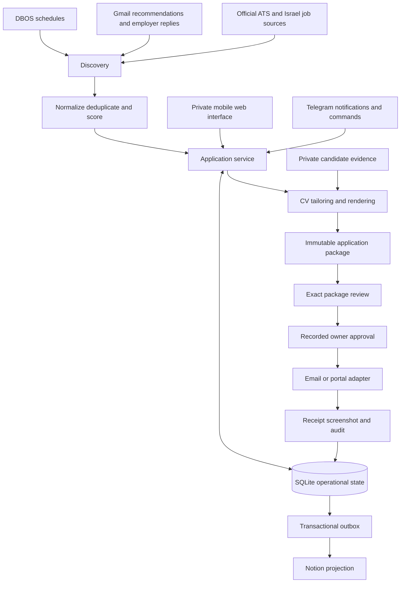

# BackendScout Architecture

Baseline: **1.1**, amended 4 November 2026. Status: frozen delivery scope.

This document is the implementation contract for the personal BackendScout
service and its separately distributed commercial skill. `EXECUTION_PLAN.yaml`
records work and evidence against this baseline. Historical research remains
useful context; this baseline takes precedence over older proposed designs.

## Product Outcomes

The personal service finds relevant Israel-based or eligible remote roles each
morning, prepares truthful job-specific CVs, collects missing answers, and delivers
an application after approval of its exact package. The phone interface presents
Today, Needs My Input, Applications and Health. Telegram carries notifications
and supports the transition from the existing interface.

The commercial product prepares an evidence-linked application pack from supplied
facts and a job description. Its first release contains CV text, a recruiter-note
draft, interview practice and an evidence audit. It is maintained in a separate
repository and ships synthetic examples. Publication readiness is independent of
the personal service's cloud migration.

## Fixed Decisions

| ID | Decision | Consequence |
| --- | --- | --- |
| D01 | Python 3.12, uv, existing Pydantic/PyYAML | Retain the current toolchain and locked dependencies. |
| D02 | Modular monolith with application services | CLI, Telegram and FastAPI call the same business operations. |
| D03 | SQLite and DBOS on one persistent host | One operational owner; transactional changes, queue and schedules. |
| D04 | Notion as a synchronized projection | A projection outage cannot stop an approved local operation after migration. |
| D05 | Private responsive web app with FastAPI | Use the browser on the phone; avoid a separate native app. |
| D06 | Telegram Bot API through existing httpx client | Reuse owner authorization and fast acknowledgements. |
| D07 | Existing OpenAI API integration with bounded calls | Deterministic discovery, scoring and state; models draft, explain and propose restricted browser actions. |
| D08 | Versioned DOCX/PDF and private evidence | Exact artifact checksums bind approval; preserve company archives. |
| D09 | Gmail API for email and reply monitoring | Existing send/read scopes; no new scope implied by migration. |
| D10 | Playwright with tested adapters and verified employer forms | One browser lane; deterministic execution, bounded AI fallback, saved receipt and uncertain-outcome reconciliation. |
| D11 | Docker on a small OVHcloud Linux VPS | Quote and account provision are deployment gates. |
| D12 | Total recurring budget ceiling 100 NIS/month | Include hosting, model usage, storage/backups, tax and exchange-rate headroom. |
| D13 | Commercial skill is self-contained text plus stdlib helper | No live personal accounts or backend-service dependency in its ZIP. |

Provider purchases, the final hosting quote, seller onboarding and marketplace
publication remain owner actions. Ordinary implementation, fixes, local tests,
documentation and isolated synthetic evaluations can proceed autonomously.
Do not substitute another framework, database, cloud or model family silently.

## Components and Data Flow



The commercial track consumes its own supplied facts and pasted job descriptions.
It shares the evidence-first method, not credentials, private files or the running
personal database. Cross-repository work uses separate file ownership.

## Application Service Contract

Business operations live outside Typer commands. Interface handlers validate
authorization, invoke the service and serialize its result. Workers invoke the
same operations and never infer success from a printed message or a zero CLI exit.

Service outcomes are typed: `succeeded`, `blocked`, `retryable_failure`,
`permanent_failure`, `uncertain`. A result carries a stable reason code, candidate
action when needed, correlation ID and references to stored artifacts. Personal
answers and credentials stay out of generic error messages.

The package contract binds application identity, tracker, company/role, official
destination, delivery route, exact CV version and checksum, and reviewed answers.
Email also binds recipient, subject and full body. Canonical serialization gives
one SHA-256 fingerprint. Answer ordering does not change meaning; changed answers,
destination, attachment, route or content produce a new fingerprint.

An immutable package is a data contract. It becomes authority to deliver only
after an authenticated owner approves that exact current fingerprint. The worker
rechecks current version, destination and actual file bytes before starting an
attempt. Model output and Notion status are never approval sources.

## Persistence and Ownership

Use the existing SQLite database, with explicit versioned migrations and foreign
keys. Keep these logical records, adding tables incrementally:

| Record | Responsibility |
| --- | --- |
| applications | Canonical job identity, official route, lifecycle and tracker |
| package_versions | Immutable reviewed payload, fingerprint and artifact references |
| approvals | Actor, package fingerprint, decision and timestamp |
| delivery_attempts | Durable intent, adapter, request identity and outcome |
| artifacts | Relative private path, type, SHA-256, version and provenance |
| outbox | Projection/notification event, stable key, retries and acknowledgement |
| workflow tasks and events | Existing claims, leases, schedules and audit history |
| inbox checkpoints | Processed message identities and evidence for status changes |

Use transactions for a state change plus its outbox event. External delivery is
outside a database transaction: persist intent, call the external service, then
persist the outcome. A crash between those steps requires reconciliation.
The existing CV files remain immutable filesystem artifacts; database references
must resolve within the configured private root and match their checksums.

Notion projection writes use stable identities. Remote edits are reconciled as
explicit commands with authorization rules. Retry projection failures separately
from delivery. Do not execute an application because an outbox event was replayed.

## Lifecycle and Approval

Target progression:

```text
discovered -> shortlisted -> drafting -> review_ready -> approved
-> preparing -> sending -> submitted
```

`needs_input`, `revision_requested`, `blocked`, `submission_unknown`, `closed`,
`rejected`, `assessment`, `interview` and `offer` are explicit outcomes or branches.
Map existing statuses during migration; historical rows keep provenance.

A job can be selected for preparation without delivery authorization. The owner
reviews the role, exact PDF, route and answers in one package screen. Approval
then permits preparation and delivery of that unchanged package without another
identical confirmation. Revision creates a new version and requires new approval.
New material form questions create `needs_input`; their answers change the package.

Keep the current multi-step gates active until the new service, persistence,
interface authorization and adapter checks pass together. Old Telegram buttons
cannot approve packages created by the new path. Test and production approvals
have different identities and never transfer.

## Discovery and Evidence

Daily discovery runs at 08:00 Asia/Hebron. The current-day watchdog recovers a
missing trigger once; it does not replay a backlog of old digests. Source failures
are distinguished from an empty successful search. Check known jobs before the
digest limit, including the tracker identity used across different source URLs.

Use configured Israeli sources, official ATS feeds and Indeed recommendation
emails. Preserve the discovery URL and verified official application URL. Capture
source health and route availability with each run. Manual commands use explicit
deduplication keys and may request a fresh run without resetting history.

Matching remains transparent and does not manufacture qualifications to reach a
target percentage. CV claims must cite confirmed private evidence. Repository
scanning proposes evidence for owner confirmation. Course, personal project,
AI-assisted work and employment remain distinguishable.

Render every CV as DOCX/PDF with labeled hyperlinks, relevant projects and the
stable configured download name `<candidate full name> CV`. Target one readable page and useful
page coverage without adding unsupported facts. Revisions retain the old file
and review record. Missing evidence becomes a focused question.

## Delivery and Reconciliation

Owner-approved amendment 1.1 adds employer-first route verification and a hybrid
browser executor behind a default-off rollout flag. Discovery and employer posting
URLs remain distinct from the reviewed application entry. A new form's identity,
questions and proposed cover note are inspected before package approval. Model
proposals never authorize navigation, values, uploads or submission; the executor
checks current observations and the exact approved package before every effect.

The browser AI allowance is 40 NIS/month within the unchanged 100 NIS project cap,
with defaults of 2 NIS/application, six model requests, forty browser actions and
ten minutes active work. Reservations survive retries and unknown outcomes;
unpriced models do not run. Successful sessions close only after saved proof and
acknowledged Telegram delivery; paused forms remain open. Three new owner-approved
production canaries are required before general enablement. Historical submitted
jobs, including the five confirmed on 4 November, are never replay targets.

Support one approved route per job. Email sends the reviewed body and verified
attachment through Gmail. Portals use known adapters and evidence-backed answers.
Unsupported questions or site-required verification return a specific input
request. WhatsApp remains a prepared user-sent handoff in this release scope.

Adapters return confirmation evidence. Portal success requires visible receipt
and a saved screenshot, with checksum, URL, CV version and timestamp recorded and
sent to the owner. Email success retains Gmail's message ID and package identity.
If the adapter may already have transmitted, use `submission_unknown`; prevent
another delivery until receipt/mail/browser evidence resolves it.

Mailbox scanning runs every 15 minutes. Match employer messages to applications
using sender/domain, role and thread evidence; ambiguous messages stay unresolved.
Exclude unrelated notifications. Apply valid lifecycle transitions with an audit
record. Urgent action requests notify immediately; routine updates join the digest.

## Mobile Interface and Authorization

Provide the four views with compact work-focused layouts and explicit pending
actions. The package review displays job facts, gaps, answers, route and exact PDF.
Repeated clicks are idempotent. The user sees a receipt or the precise remaining
question, and can request a revision without locating an application ID manually.

Use owner-only browser sessions with an opaque token stored hashed in SQLite,
HttpOnly/Secure/SameSite cookies, CSRF protection, session expiry and origin checks.
Pair the browser through a short-lived, single-use code issued only to the
allowlisted Telegram owner. Rate-limit pairing attempts. Artifact endpoints check
the session and application ownership. Secrets or reusable approval tokens do not
belong in URLs, logs or public Notion fields.

Develop against loopback first. Production ingress must provide HTTPS before any
public exposure. Final domain/ingress provisioning is part of the hosting gate;
it must fit the existing budget and does not require another paid SaaS product.

## Operations and Cost

Run one scheduler owner, a general worker, a single-concurrency browser worker and
the web/interface process. Docker processes share one persistent private volume.
The browser has a dedicated profile. Keep macOS Keychain for current local use;
add a portable owner-restricted secret provider for Linux and authorize Gmail on
the target environment. Do not migrate the personal browser profile as a shortcut.

Liveness, fresh workflow outcomes, source availability and credential health are
different checks. A queued retry does not clear a blocked outcome. Send actionable
alerts with deduplication, not repeating diagnostic dumps. Preserve correlation
IDs and redact credentials and private answers.

Meter model usage per call, package and day. Cache immutable extraction and bound
retries. Use existing configured models until an explicit migration decision.
Enforce model spending against the available part of the 100 NIS total budget;
hosting charges are not controlled by an API token limit. Obtain an all-in quote
and set provider alerts before purchase.

Back up SQLite consistently with artifacts and metadata needed to resolve its
references. Protect private backups and test restoration. Cut over after a shadow
discovery run and a restore/restart test. Disable the Mac scheduler before enabling
cloud ownership. Verify a morning digest with the Mac off; then retire the old
runtime only after the acceptance evidence is recorded.

## Delivery and Change Control

Follow dependency-ready tasks in `EXECUTION_PLAN.yaml`. Main integration owns
shared interfaces and progress updates. Subagents own disjoint modules, tests or
commercial files and can run concurrently. A task is complete only with acceptance
evidence, not a worker's claim that it finished.

Run focused tests, review changes, integrate, then run the relevant project checks.
Keep a functioning production routine while adding new paths behind explicit
cutover switches. Update README and SYSTEM_BUILD_GUIDE at milestones. Never copy
private material into either repository's distributable files.

Baseline decisions, budget and public product scope change only by a recorded
owner-directed amendment and version bump. Fixes that satisfy the contract are
routine implementation. If an external gate is unavailable, record the concrete
blocker and continue independent ready tasks. New commits, pushes and publication
follow the owner's active authorization; this baseline itself grants none.

This protocol governs development in active agent sessions. Runtime schedules
continue in the installed service; a document alone does not start a background
development agent. The status tool reports next work without executing it.

## Definition of Complete

The personal release is complete after local migration, package approval,
projection isolation, mobile review, fixture-tested delivery, mailbox matching,
backup restore and Linux restart tests pass, followed by an owner-approved real
application with proof and a morning cloud digest while the Mac is off.

The commercial release is ready for submission when the exact ZIP passes local
checks and the advertised delivery test, product claims match observed behavior,
seller/payout/price/license decisions are recorded, and the final listing is
approved for publication. Marketplace moderation and public listing availability
are separately verified external outcomes. Its requirements and gaps live in the
commercial repository's readiness report and release checklist.
